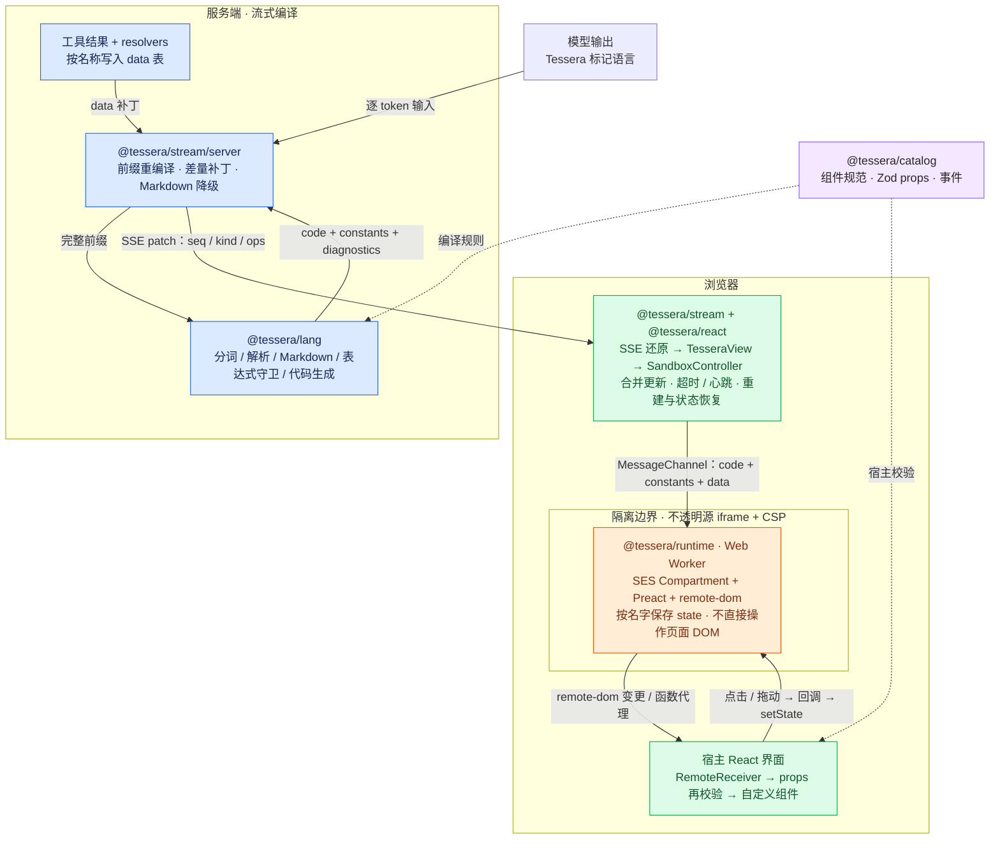
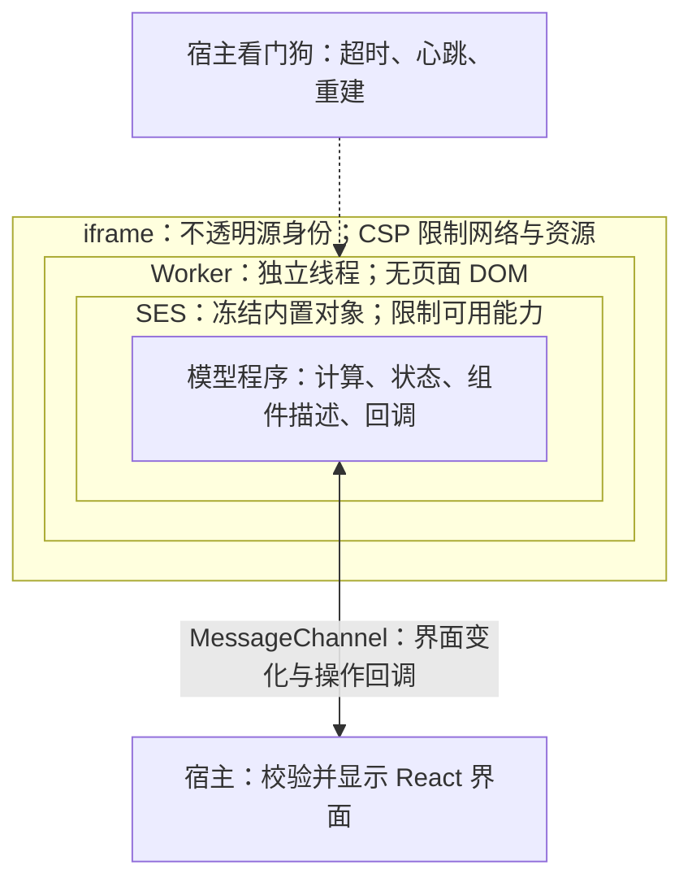

# Tessera 项目架构

本文记录当前工作区的实现，包括尚未提交的代码；不是改造提案。

可编辑画布：[Tessera · 项目架构](https://www.tldraw.com/f/OqGj4u4Yr7r8ezekqMyII)。

## 当前实现

- **共享组件目录**：`@tessera/catalog` 定义 props、事件、子内容、resolver 和 fallback，提供编译及宿主校验。代码依据：`packages/catalog/src/index.ts:124`、`:143`、`:153`。
- **编译器**：`compile()` 将标记语言分词、解析、转换 Markdown 并生成代码及常量表，代码生成阶段调用表达式守卫。依据：`packages/lang/src/compile.ts:45`、`packages/lang/src/codegen.ts:222`。
- **流式服务端**：每次重新编译已收到的完整前缀，再差量发送 code、constants、diagnostics 和 data；结束时附 Markdown 降级版。工具数据由调用者传入，resolver 结果异步补入 data。依据：`packages/stream/src/server.ts:40`、`:154`。
- **浏览器控制层**：`useTesseraStream()` 还原流式文档，`TesseraView` 把程序交给 `SandboxController`。控制器合并更新、监测超时和心跳、重建沙箱并恢复最近成功状态。依据：`packages/react/src/useTesseraStream.ts:37`、`packages/react/src/TesseraView.tsx:32`、`packages/react/src/controller.ts:170`、`:211`、`:238`。
- **隔离执行**：`iframeSandbox` 建立不透明源 iframe 和 CSP，iframe 启动 Blob Worker，并转交 MessagePort；之后宿主与 Worker 直连。Worker 执行 lockdown，再在 SES Compartment 中求值。依据：`packages/react/src/sandbox.ts:60`、`packages/runtime/src/worker.ts:11`、`packages/runtime/src/runtime.ts:159`。
- **界面与交互**：Worker 内 Preact 维护 remote-dom 树，宿主 RemoteReceiver 接收变更，经组件目录再次校验 props 后交给 React 组件。事件回调返回沙箱、更新按名字保存的 state，再产生树差异。依据：`packages/runtime/src/runtime.ts:18`、`packages/react/src/RemoteTree.tsx:78`。
- **动作出口**：`ui.send()` 通过 onAction 交给宿主，由宿主决定是否触发下一轮模型调用；普通 state 更新不调用模型。依据：`packages/react/src/TesseraView.tsx:32` 及该文件的 onAction 接口说明。
- **埋点与统计（M6）**：`compile()` 同时输出 manifest，按源码顺序列出每个组件的 site、父组件、来源、字面量与绑定 props、事件、循环与条件，以及布局骨架和 state 名。codegen 给每个组件注入 `__site`（`{#each}` 内带实例下标），运行时把它作为元素的 `site` 属性传给宿主，宿主校验格式后经 `useTesseraSite()` 交给宿主组件。site 来自 Worker，只作提示，采信前需与 manifest 核对。依据：`packages/lang/src/manifest.ts:32`、`packages/lang/src/codegen.ts:120`、`:177`、`packages/runtime/src/runtime.ts:109`、`packages/react/src/RemoteTree.tsx:42`、`:107`。

## 架构图 AR-1

读图方式：沿模型、流式服务端、浏览器控制层、隔离 Worker、宿主界面这条路径阅读；底部双向箭头是本地交互回路，组件目录向编译与显示两端提供共同约束。画布中的说明卡片补充了动作出口和应用接入方式。

## 接入方式与边界

- `demo/` 包含源码编辑器、聊天页及短视频广告位。聊天页的服务端使用 `createSSEStream`；依据：`demo/src/server/chat.ts:30`。
- `integrations/dsh-plugin/` 提供 Harness 的 `render_ui` 工具：服务端编译以反馈诊断并绑定工具数据；浏览器读取流式参数中的 source 前缀进行编译，随后由同一套 TesseraView 和沙箱显示。工具数据通过结果的 presentationMeta 传递。依据：`integrations/dsh-plugin/README.md`、`integrations/dsh-plugin/src/host.ts:1`、`integrations/dsh-plugin/src/client.tsx:206`。
- 插件的统计（M6）：服务端半边在 `127.0.0.1:4317` 起收集服务和统计页，地址同样经 presentationMeta 交给浏览器；浏览器半边为每个界面建一个 ViewTracker，包装宿主组件以记录可见时长和事件，再上报 manifest、动作、state 变化和问题。只收本机页面的事件，数据写在插件目录的 `.telemetry/`。依据：`integrations/dsh-plugin/src/host.ts:119`、`integrations/dsh-plugin/src/collector.ts:46`、`integrations/dsh-plugin/src/track.ts:107`、`:245`。
- 因而主图中的“服务端编译 + SSE”是一种已实现接入路径，编译器也可在浏览器运行，并非所有集成都经过 SSE 服务。
- 图示使用 `iframeSandbox`；另有 `workerSandbox`，它没有 iframe 的不透明源和 CSP 这一层。依据：`packages/react/src/sandbox.ts:106`。
- `eval/`、`scripts/` 和 `docs/walkthrough/` 是评测、构建及导读设施，不属于单次界面渲染链路；目录角色来自 README 和根 package.json。

## 隔离展开 AR-2

从 AR-1 中用户选中的隔离框 `shape:7YO6F2YEmlFCldQj-lZS0`，用橙色虚线引出右侧的“用 8 个问题理解沙箱”讲解区。套框表示运行位置，不表示顺序调用。

读图方式：模型程序在层层约束的环境中执行，通过明确的消息接口与宿主交互；看门狗在宿主侧监测和恢复沙箱。

画布按八个问题讲解：

1. 为什么需要沙箱？限制生成代码的数据访问、联网和故障影响。
2. 怎样隔开宿主页面与数据？iframe 的 sandbox 和不透明源身份。
3. 怎样阻止任意联网？CSP；Blob Worker 继承 iframe 的策略。
4. 怎样把程序执行与页面操作分开？Web Worker 独立线程。
5. 程序究竟能拿到哪些工具？SES 只向程序暴露指定能力。
6. 代码一直不结束怎么办？宿主看门狗检测、终止、重建和恢复。
7. 不能操作 DOM，界面由谁画？宿主校验 remote-dom 变化，再用 React 组件显示；回调传回 Worker。
8. 能自己发消息给模型吗？ui.send() 经 onAction 交给宿主决定。

另有授权提示：宿主主动传入的数据可被程序读取，开放的动作接口可被请求调用。实现依据沿用本页当前实现中的 sandbox、runtime、controller、RemoteTree 和 TesseraView 源码。

## Decisions

### D-1 — 本次采用现状图

2026-10-20：按用户“用 tldraw 画项目架构图”的请求，以当前代码为依据绘制可编辑架构图，同时保存 Mermaid。此项是本次文档表达选择，不推断项目历史设计动机；不提出源码修改方案。

## Open questions

无阻碍本次架构绘制的问题。

## Acceptance criteria

| ID | 条件 | 证据 | 状态 |
|---|---|---|---|
| AC-1 | 覆盖五个核心包与运行边界 | AR-1；上面的代码依据 | done |
| AC-2 | 区分流式传输、本地交互和模型动作出口 | AR-1；画布“交互与隔离”说明卡片 | done |
| AC-3 | 在 tldraw 中提供可编辑图形 | 画布 OqGj4u4Yr7r8ezekqMyII；26 个图形；页面截图已检查 | done |
| AC-4 | 区分 SSE 接入与 Harness 接入 | 画布“应用接入”；本页接入说明 | done |

## Changelog

- 2026-10-20 — 根据当前工作区代码绘制 AR-1，检查截图并调整标签与连线；补充 demo、Harness 和纯 Worker 模式说明。只新增设计文档，未执行运行时测试。
- 2026-10-20 — 按用户选中框新增隔离展开 AR-2：嵌套运行边界、八个讲解问题、宿主通信与恢复机制；已检查选区和视口截图，确认引线连接原隔离框。
- 2026-10-21 — 记入 M6（埋点与统计）：当前实现新增 manifest / site 一条，接入说明新增插件统计一条；按代码现状更新了因 M6 改动而移位的行号依据。AR-1、AR-2 和 tldraw 画布未改，图中尚未画出 site 与统计的路径。

